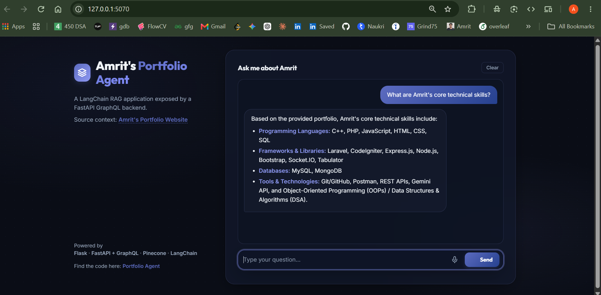
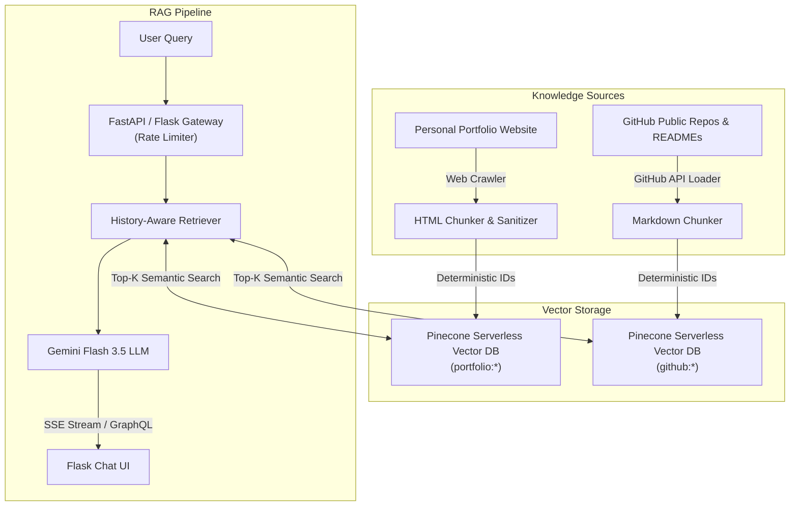
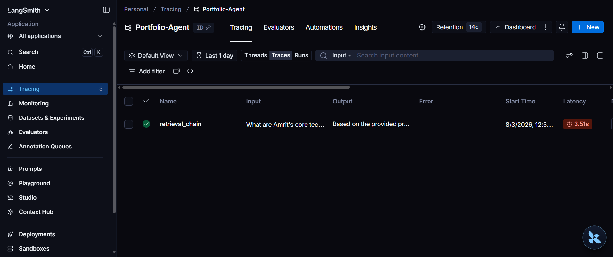
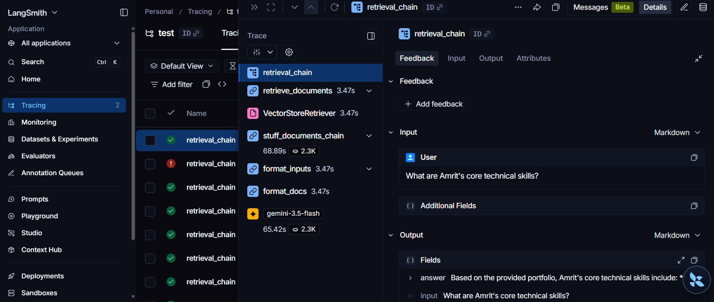

# Multi-Source RAG Portfolio Assistant

[](https://python.org)
[](https://fastapi.tiangolo.com)
[](https://flask.palletsprojects.com)
[](https://github.com/langchain-ai/langchain)
[](https://pinecone.io)
[](https://ai.google.dev/)
[](tests/)

A production-grade, multi-source Retrieval-Augmented Generation (RAG) assistant that indexes and synthesizes knowledge from **personal portfolio web pages** and **live GitHub repositories & READMEs**.

Built with **LangChain**, **FastAPI + Strawberry GraphQL**, **Flask**, **Google Gemini (Embeddings & Chat)**, **Pinecone Serverless Vector DB**, and **LangSmith** for observability.

🔗 **Live Deployment:** [portfolio-agent-sk6z.onrender.com](https://portfolio-agent-sk6z.onrender.com/)

---

## 📱 Application Preview



### Try Asking:
* *"What projects has Amrit built recently?"*
* *"Tell me about Amrit's secure token manager project."*
* *"What tools and technologies does he use for Flutter or backend development?"*
* *"What experience or projects are listed on his portfolio website?"*

---

## ✨ Key Features

### 1. 🌐 Multi-Source Knowledge Ingestion
* **Personal Portfolio Website**: Recursively crawls [amrit-2002.github.io/Portfolio](https://amrit-2002.github.io/Portfolio/) to discover and extract profile, skills, and background information.
* **GitHub Repository Synchronization**: Automatically fetches public repositories, metadata (stars, languages, topics, update dates), and full `README.md` contents for GitHub projects.

### 2. ⚡ Reliable & Idempotent Synchronization
* **Deterministic Vector IDs**: Vector chunk IDs are computed using a SHA-256 hash of the normalized source type, resource identity, and chunk content (`github:{repo_full_name}:{hash}` and `portfolio:{url_slug}:{hash}`).
* **Safe Replacement**: When a repository or README updates, new chunks are embedded and upserted *before* old vectors are pruned.
* **Idempotent by Design**: Unchanged repositories are automatically detected by chunk hash equality, avoiding unnecessary re-indexing and saving LLM/Pinecone API quota.
* **Failure-Resistant**: If the GitHub API returns an error or rate-limit response (HTTP 403/429), existing vectors are preserved and never prematurely deleted.
* **Source Isolation**: Personal portfolio vectors are protected with isolated prefixes and are never modified or purged during GitHub sync operations.

### 3. 💬 Modern Chat Experience
* **Real-time SSE Streaming**: Responses stream token-by-token directly to the chat bubble.
* **Stop / Abort Generation**: Users can cancel long-running AI streams at any time using an `AbortController`.
* **One-Click Copy**: Quick "Copy" button on every AI response bubble.
* **Intuitive Keyboard Controls**: Standard chat convention (<kbd>Enter</kbd> to send, <kbd>Shift</kbd> + <kbd>Enter</kbd> for newline).
* **Mobile Viewport Optimization**: Built with dynamic viewport units (`100dvh`) to prevent mobile keyboard layout shifts.

### 4. 🛡️ In-Memory Rate Limiting
* Sliding-window IP rate limiter (`InMemoryRateLimiter`) protecting `/ask` and `/ask-stream` from bot scraping, denial-of-service, and quota exhaustion.
* Graceful HTTP 429 response handling on both backend and frontend.

---

## ⚙️ Architecture & Data Flow



---

## 🚀 Getting Started

### Prerequisites
* **Python 3.12+**
* **Google Gemini API Key** (for embeddings and chat generation)
* **Pinecone API Key & Index** (vector search database)
* **LangSmith API Key** *(optional, for execution tracing and observability)*
* **GitHub Personal Access Token** *(optional, increases GitHub API rate limit from 60 to 5,000 req/hr)*

---

### Installation & Setup

1. **Clone the repository:**
   ```bash
   git clone https://github.com/Amrit-2002/portfolio-agent.git
   cd portfolio-agent
   ```

2. **Set up a Virtual Environment:**
   * **Windows (PowerShell):**
     ```powershell
     python -m venv .venv
     .\.venv\Scripts\activate
     ```
   * **macOS / Linux:**
     ```bash
     python3 -m venv .venv
     source .venv/bin/activate
     ```

3. **Install Dependencies:**
   ```bash
   pip install --upgrade pip
   pip install -r requirements.txt
   ```

4. **Configure Environment Variables:**
   Create a `.env` file in the root directory (refer to [`.env.example`](file:///.env.example)):
   ```env
   # Pinecone
   PINECONE_API_KEY=your_pinecone_api_key
   PINECONE_INDEX_NAME=portfolio-rag-3072

   # Google Gemini
   GOOGLE_API_KEY=your_google_gemini_api_key
   LLM_MODEL=gemini-3.5-flash
   EMBEDDING_MODEL=models/gemini-embedding-2-preview

   # GitHub Integration
   GITHUB_USERNAME=Amrit-2002
   # GITHUB_TOKEN=your_optional_github_token

   # Rate Limiting & Portfolio Source
   RATE_LIMIT_PER_MINUTE=10
   PORTFOLIO_URL=https://amrit-2002.github.io/Portfolio/

   # LangSmith Observability (Optional)
   LANGSMITH_TRACING=true
   LANGSMITH_API_KEY=your_langsmith_api_key
   LANGSMITH_PROJECT=Portfolio-Agent
   ```

---

### Running Locally

1. **Start the FastAPI Backend:**
   ```bash
   python -m uvicorn app.backend:app --host 127.0.0.1 --port 8000 --reload
   ```

2. **Start the Flask Frontend:**
   ```bash
   python web/frontend_app.py
   ```

3. **Access the Web App:**
   Open your browser and navigate to `http://localhost:5070`.

---

### GitHub Synchronization

#### Via CLI:
Synchronize your GitHub repositories and READMEs into Pinecone directly from the command line:
```bash
python -m app.rag_application --sync-github
```

#### Via API:
Trigger synchronization via HTTP endpoint:
```bash
curl -X POST http://localhost:8000/v1/sync/github
```
**Example Response:**
```json
{
  "status": "success",
  "discovered_count": 24,
  "added_count": 0,
  "updated_count": 0,
  "unchanged_count": 24,
  "deleted_count": 0,
  "vectors_upserted": 0,
  "projects_synced": 24,
  "errors": []
}
```

---

## 🧪 Testing & Code Quality

The project includes an extensive automated test suite with **92 tests** covering web crawling, GitHub loading, idempotent synchronization, deterministic ID generation, rate limiting, and API endpoints.

### Run All Tests:
```bash
pytest
```

### Run Linting & Formatting Checks:
```bash
ruff check .
ruff format --check .
```

---

## 🌐 Deployment on Render

This project is configured to run on Render's **Free Tier** as a single consolidated service to avoid multi-container overhead and minimize cold starts.

* **Language:** Python 3
* **Build Command:** `pip install -r requirements.txt`
* **Start Command:** `chmod +x start.sh && ./start.sh`
* **Configuration:** [`.python-version`](file:///.python-version) forces Python `3.12.10`, and [`start.sh`](file:///start.sh) launches both FastAPI and Flask concurrently.

---

## 🛠️ Tech Stack

* **AI & RAG:** LangChain, Google Gemini Flash 3.5, Gemini Embedding 2 Preview
* **Vector Database:** Pinecone Serverless (`cosine`, 3072 dimension)
* **Backend:** FastAPI, Strawberry GraphQL, Uvicorn, SSE (Server-Sent Events)
* **Frontend:** Flask, HTML5, CSS3, Vanilla JavaScript, Fetch/EventSource API
* **Observability:** LangSmith
* **Data Ingestion:** BeautifulSoup4, Requests, GitHub REST API v3
* **Tooling & Quality:** Pytest, Ruff, Python-Dotenv

---

## 🔍 Tracing & Observability with LangSmith

LangChain integrates with LangSmith to trace query execution, latency, prompt templates, and retrieved context chunks:



*Detailed breakdown of LLM inputs, outputs, and retrieved document chunks:*

