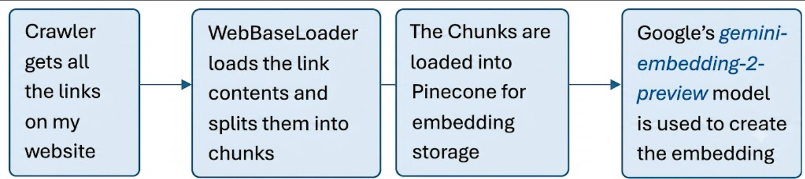
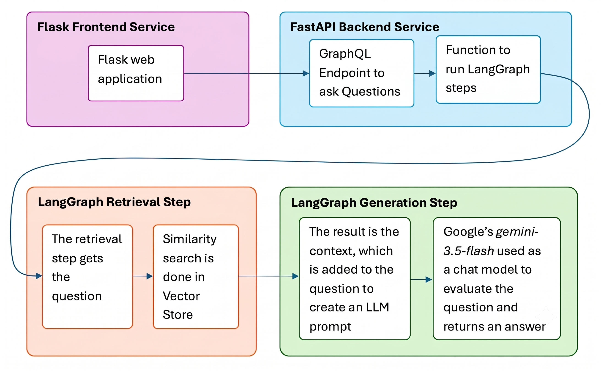

# A RAG Application Using LangChain

[](https://python.org)
[](https://fastapi.tiangolo.com)
[](https://flask.palletsprojects.com)
[](https://github.com/langchain-ai/langchain)
[](https://pinecone.io)

This project showcases a Retrieval-Augmented Generation (RAG) pipeline utilizing a LangChain retrieval architecture. The backend is served via **FastAPI + Strawberry GraphQL** (with vector search in **Pinecone**), and the user interface is built on **Flask**.

🔗 **Live Deployment:** [portfolio-agent-sk6z.onrender.com](https://portfolio-agent-sk6z.onrender.com/)

---

## 📱 Application Preview


The RAG application uses my personal website [amrit-2002.github.io/Portfolio](https://amrit-2002.github.io/Portfolio/) as the source of information to answer questions. The website is crawled, chunked, embedded, and stored in Pinecone for semantic retrieval.

### Try Asking:
* *"What projects are on his website?"*
* *"What tools does he use for data engineering?"*

---

## ⚙️ How It Works

### 1. The Indexing Process

A crawler crawls the target website to discover all loadable links. The contents of these pages are extracted, chunked for context-window optimization, converted into vector embeddings using Google's `gemini-embedding-2-preview` model, and stored in a Pinecone vector database.

### 2. The Question-and-Answer Process

When a user enters a question, the Flask frontend sends a request to the FastAPI GraphQL backend. The backend computes the embedding of the query, performs a similarity search in Pinecone to find the most relevant context, and passes both the query and context to Google's Gemini Flash chat model to generate a factual response.

---

## 🚀 Getting Started

### Prerequisites
You will need API keys for the following services:
* **Google Gemini AI** (for embedding generation and chat responses)
* **Pinecone** (vector search database)
* **LangSmith** (optional, for tracing and observability)

### Installation & Setup

1. **Clone the repository:**
   ```bash
   git clone https://github.com/Amrit-2002/portfolio-agent
   cd portfolio-agent
   ```

2. **Set up a Virtual Environment:**
   * **Windows (PowerShell):**
     ```powershell
     python -m venv .venv
     .venv\Scripts\activate
     ```
   * **macOS / Linux:**
     ```bash
     python3 -m venv .venv
     source .venv/bin/activate
     ```

3. **Install Dependencies:**
   ```bash
   pip install --upgrade pip
   pip install -r requirements.txt
   ```

4. **Configure Environment Variables:**
   Create a `.env` file in the root directory:
   ```env
   GOOGLE_API_KEY=Your_Google_API_key
   PINECONE_API_KEY=Your_Pinecone_API_key
   LANGSMITH_API_KEY=Your_LangSmith_API_key
   LANGSMITH_TRACING=true
   ```

### Running the Application Locally

1. **Start the FastAPI Backend:**
   ```bash
   python -m uvicorn app.backend:app --host 127.0.0.1 --port 8000 --reload
   ```

2. **Start the Flask Frontend:**
   ```bash
   python web/frontend_app.py
   ```

3. **Access the Web App:**
   Open your browser and navigate to `http://localhost:5070`

---

## 🌐 Deployment on Render

This project is configured to run on Render's **Free Tier** in a single consolidated service to minimize cold starts and resource consumption.

### Setup Settings:
* **Language:** `Python 3`
* **Build Command:** `pip install -r requirements.txt`
* **Start Command:** `chmod +x start.sh && ./start.sh`
* **Configured via:** [`.python-version`](file:///.python-version) (forces Python `3.12.10`) and [`start.sh`](file:///start.sh) (runs both processes concurrently).

---

## 🛠️ Technologies Used

* **Orchestration:** LangChain, LangSmith (tracing)
* **API & Backend:** FastAPI, Strawberry GraphQL
* **Frontend:** Flask, HTML5, Vanilla CSS, JavaScript
* **Models:** Google Gemini Flash 3.5, Google gemini-embedding-2-preview
* **Database:** Pinecone Vector Database
* **Crawling & Parsers:** BeautifulSoup4, Requests

---

## 🔍 Tracing & Observability with LangSmith

LangChain integrates seamlessly with LangSmith to trace performance, step runtimes, inputs, and outputs across the chain.


*Detailed breakdown of LLM inputs, outputs, and retrieved document chunks:*


*(Note: LangSmith tracing requires a LangSmith account).*